# Relatório de Testes — DoaBem

**UNIVILLE · Engenharia de Software · Fábrica de Software · P05**

DoaBem — Sistema de Gestão de Doações e Distribuição de Recursos

| Item | Informação |
|---|---|
| Projeto | P05 · DoaBem (MVP) |
| Cliente / PO | Prof. William Sestito |
| Equipe | João Miguel Zazula Lopes, Gabriel Hardt, Eduardo Angeli, Kaue Dylon Pereira Bruch, Vitor Viebranz Domingos |
| Responsável pelos testes (QA) | Vitor Viebranz Domingos. Execução assistida por IA (Claude) em 17/11/2026. |
| Versão testada | Instância em execução no ambiente local (frontend em localhost:5173, API em localhost:8080). Referência do repositório: branch main, commit d3f9b77. |
| Data da execução | 17/11/2026 |
| Prazo final do projeto | 05/12/2026 (escopo congelado em 16/11/2026) |

Este relatório reúne os casos de teste do MVP, o resultado de cada execução, as evidências e os defeitos encontrados. Os requisitos e as regras citados (RF, RN, RNF, CA, Q, D) estão em docs/requisitos.md e docs/decisoes.md do repositório.

## 1. Escopo e estratégia

Objetivo: verificar se o MVP cumpre o fluxo de aceite mínimo do briefing, as regras de negócio obrigatórias, os perfis de acesso e o tratamento de cenários inválidos, com evidência de cada resultado.

### 1.1 O que foi testado

- Autenticação, perfis (Operador e Coordenador) e usuário inativo.
- Cadastro de categorias, itens, famílias e usuários, com validações.
- Entrada de doação (vários itens, atomicidade, unidades UN/KG/L).
- Estoque derivado de movimentações, saldo crítico, ajustes e estornos.
- Solicitação → aprovação (total, parcial, recusa) → separação com reserva → entrega com baixa, e cancelamento.
- Históricos, filtros e dashboard, com conferência cruzada dos números.
- Navegação e permissões pela interface, e um fluxo completo na tela (nova entrada).

### 1.2 Como foi executado

- Testes de API (casos como AUT, ENT, SOL): requisições feitas no Swagger UI da própria API, no navegador, com o token do Coordenador ou do Operador. O print do Swagger mostra o curl enviado, a URL, o código HTTP e a resposta do servidor. As pré-condições de alguns casos (dados prévios) foram preparadas por script antes do teste; a requisição testada em si é a do print.
- Testes de interface (casos UI): execução manual no navegador, com a captura de tela logo abaixo do caso, na linha de evidência.
- Critério de aprovação: o resultado obtido coincide com o esperado, que vem dos requisitos e das respostas do PO, e não do comportamento do código.
- As dúvidas D-03, D-04, D-07 e D-09, que estavam abertas com o PO, foram respondidas em 17/11/2026; os casos ITM-09, FAM-08, SOL-22 e EXT-07 foram avaliados contra essas respostas.
- Suíte JUnit do backend (mvn test, JDK 21, em container): 143 testes, 0 falhas, 0 erros, BUILD SUCCESS, depois da correção do DEF-01.

### 1.3 O que não foi executado

| Item | Motivo / pendência |
|---|---|
| Senha armazenada com hash (RNF02) | Não verificada: exige inspeção do banco. Pelo comportamento, a senha é validada corretamente no login (USR-02). |
| Concorrência na separação/baixa (RNF03) | Não executada: exige duas requisições simultâneas e verificação do lock. |
| Responsividade e acessibilidade (RNF01) | Não avaliadas além do tamanho de tela usado nos testes. |
| Estorno de entrega com itens devolvidos (RN22/D-02) e estorno de ajuste | Não executados neste ciclo. |
| Telas de Famílias, Itens e categorias, Histórico e fluxo Solicitação→Entrega na tela | Fluxo validado pela API; a repetição pela interface fica como próximo passo. |

## 2. Ambiente e massa de dados

| Item | Detalhe |
|---|---|
| Frontend | http://localhost:5173 (React/Vite) |
| Backend | http://localhost:8080, API REST (Spring Boot). Swagger UI em /swagger-ui/index.html no perfil dev. |
| Usuários de teste | coordenador@doabem.local (Coordenador) e operador@doabem.local (Operador), credenciais fictícias de demonstração documentadas no README do backend. |
| Momentos da execução | Todos os casos de API foram executados no Swagger UI, com o backend no perfil dev e a base reiniciada (vazia, sem dados de demonstração), em sequência na mesma base: o que um caso cria é usado pelos seguintes. Os casos de tela (UI) foram executados antes, na aplicação em localhost:5173, com os dados de demonstração então existentes. |
| Massa criada pelos testes | Categorias, itens, famílias, solicitações e usuários criados durante a execução (por exemplo Carla Mendes Souza, Usuário Inativo, Alimentos, AAA Leite crítico). Com o banco H2 em memória do perfil dev, reiniciar o backend antes da demonstração limpa tudo. |
| Massa pré-existente | A base estava vazia no início da execução dos casos de API (apenas os usuários de demonstração Coordenador e Operador). |

## 3. Resumo dos resultados

| Módulo | Casos | Aprovados | Reprovados | % aprovados |
|---|---|---|---|---|
| 1. Autenticação e perfis | 7 | 7 | 0 | 100% |
| 2. Usuários internos | 5 | 5 | 0 | 100% |
| 3. Categorias e itens | 15 | 15 | 0 | 100% |
| 4. Entradas de doação | 10 | 10 | 0 | 100% |
| 5. Estoque, saldo e ajustes | 6 | 6 | 0 | 100% |
| 6. Famílias/beneficiários | 8 | 8 | 0 | 100% |
| 7. Solicitação, separação e entrega | 22 | 22 | 0 | 100% |
| 8. Estorno | 7 | 7 | 0 | 100% |
| 9. Históricos e dashboard | 8 | 8 | 0 | 100% |
| 10. Requisitos não funcionais | 2 | 2 | 0 | 100% |
| 11. Execução pela interface (tela) | 8 | 8 | 0 | 100% |
| Total | 98 | 98 | 0 | 100% |

Conclusão: dos 98 casos executados, 98 foram aprovados e nenhum foi reprovado. O único defeito encontrado (DEF-01, caso ITM-09) foi corrigido pela equipe e o caso foi reexecutado com sucesso. As regras centrais do briefing (estoque nunca negativo, reserva atômica, baixa na entrega, cancelamento liberando reserva, estorno auditável e permissões por perfil) se comportaram como esperado. As 4 dúvidas que estavam abertas com o PO foram respondidas em 17/11/2026 e estão refletidas nos casos.

## 4. Casos de teste

Legenda: Oper. = Operador; Coord. = Coordenador. Status: Aprovado ou Reprovado. A evidência dos casos de API é a requisição (método, rota, corpo enviado) e a resposta recebida, copiadas da execução; a dos casos de tela é a imagem logo abaixo do caso.

### 1. Autenticação e perfis

#### AUT-01 · Aprovado

| Requisito / regra | Perfil | Status |
|---|---|---|
| RF01 | Coord. | Aprovado |

- **Passos e dados de entrada:** POST /api/auth/login com coordenador@doabem.local e senha de demonstração.
- **Resultado esperado:** HTTP 200 e token de acesso devolvido.
- **Resultado obtido:** HTTP 200; resposta traz accessToken e role COORDINATOR.

**Evidência de AUT-01:**

#### AUT-02 · Aprovado

| Requisito / regra | Perfil | Status |
|---|---|---|
| RF01 | Oper. | Aprovado |

- **Passos e dados de entrada:** POST /api/auth/login com operador@doabem.local e senha de demonstração.
- **Resultado esperado:** HTTP 200 e token de acesso devolvido.
- **Resultado obtido:** HTTP 200; resposta traz accessToken e role OPERATOR.

**Evidência de AUT-02:**

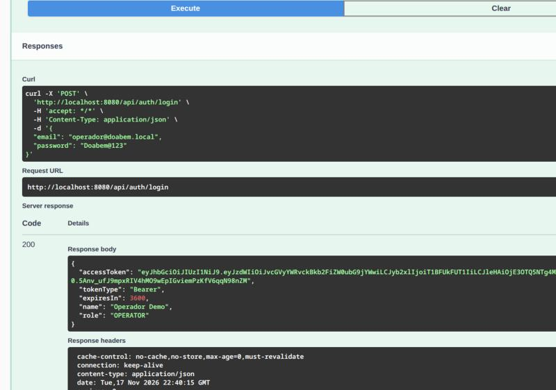

#### AUT-03 · Aprovado

| Requisito / regra | Perfil | Status |
|---|---|---|
| RF01 | Público | Aprovado |

- **Passos e dados de entrada:** Login com e-mail válido e senha incorreta.
- **Resultado esperado:** HTTP 401 com mensagem clara de credencial inválida.
- **Resultado obtido:** HTTP 401: E-mail ou senha inválidos. Tente novamente.

**Evidência de AUT-03:**

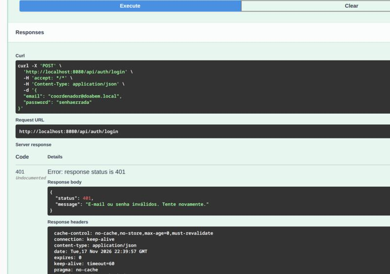

#### AUT-04 · Aprovado

| Requisito / regra | Perfil | Status |
|---|---|---|
| RF01, RNF02 | Público | Aprovado |

- **Passos e dados de entrada:** Login com e-mail e senha vazios.
- **Resultado esperado:** HTTP 400 com erro por campo (validação no backend).
- **Resultado obtido:** HTTP 400: Informe a senha. Informe o e-mail. (erro por campo)

**Evidência de AUT-04:**

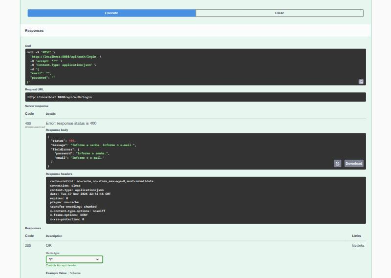

#### AUT-05 · Aprovado

| Requisito / regra | Perfil | Status |
|---|---|---|
| RF03, RNF02 | Sem login | Aprovado |

- **Passos e dados de entrada:** GET /api/items sem token.
- **Resultado esperado:** HTTP 401/403: rota protegida.
- **Resultado obtido:** HTTP 401 (sem token, rota protegida).

**Evidência de AUT-05:**

#### AUT-06 · Aprovado

| Requisito / regra | Perfil | Status |
|---|---|---|
| RF03 | Oper. | Aprovado |

- **Passos e dados de entrada:** GET /api/auth/me com token do Operador.
- **Resultado esperado:** HTTP 200 com e-mail e perfil OPERATOR.
- **Resultado obtido:** HTTP 200; email operador@doabem.local, role OPERATOR.

**Evidência de AUT-06:**

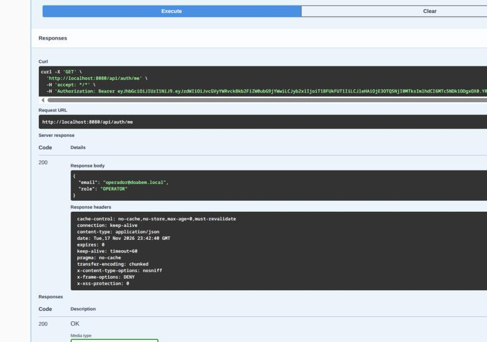

#### AUT-07 · Aprovado

| Requisito / regra | Perfil | Status |
|---|---|---|
| RF04, RN28, CA08 | Coord. | Aprovado |

- **Passos e dados de entrada:** Criar usuário, desativá-lo e tentar autenticar.
- **Resultado esperado:** Desativação com HTTP 200; login do usuário inativo recusado (401/403).
- **Resultado obtido:** HTTP 401: login do usuário inativo recusado. (Usuário criado e desativado previamente, na preparação.)

**Evidência de AUT-07:**

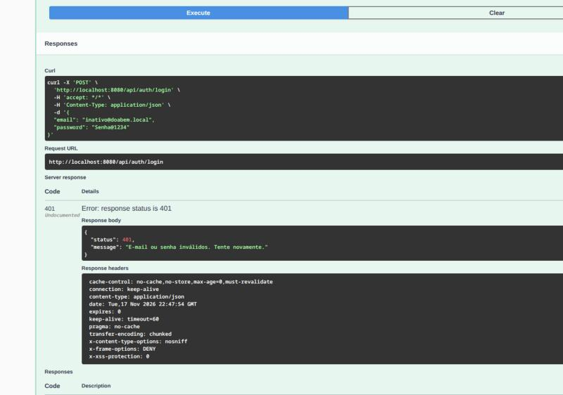

### 2. Usuários internos

#### USR-01 · Aprovado

| Requisito / regra | Perfil | Status |
|---|---|---|
| RF05 | Coord. | Aprovado |

- **Passos e dados de entrada:** POST /api/users com nome, e-mail, senha de 8+ caracteres e perfil.
- **Resultado esperado:** HTTP 201 e usuário criado como ativo.
- **Resultado obtido:** HTTP 201; usuário criado, ativo, perfil OPERATOR.

**Evidência de USR-01:**

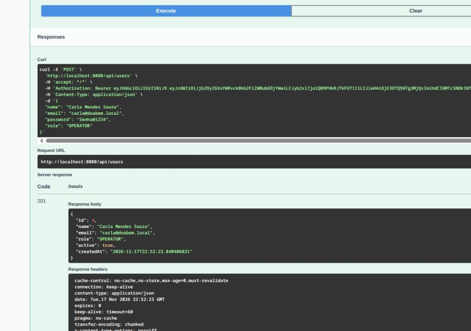

#### USR-02 · Aprovado

| Requisito / regra | Perfil | Status |
|---|---|---|
| RF05 | Novo usuário | Aprovado |

- **Passos e dados de entrada:** Login com o usuário recém-criado.
- **Resultado esperado:** HTTP 200 (senha armazenada e validada corretamente).
- **Resultado obtido:** HTTP 200; login do usuário recém-criado (Carla Mendes Souza, OPERATOR).

**Evidência de USR-02:**

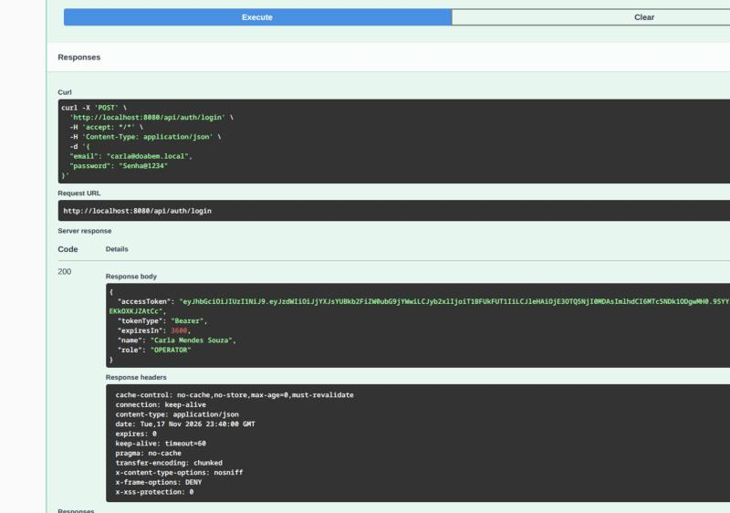

#### USR-03 · Aprovado

| Requisito / regra | Perfil | Status |
|---|---|---|
| RF05 | Coord. | Aprovado |

- **Passos e dados de entrada:** Criar usuário com e-mail já existente.
- **Resultado esperado:** Recusa (400/409) com mensagem de e-mail duplicado.
- **Resultado obtido:** HTTP 409: Já existe um usuário com este e-mail.

**Evidência de USR-03:**

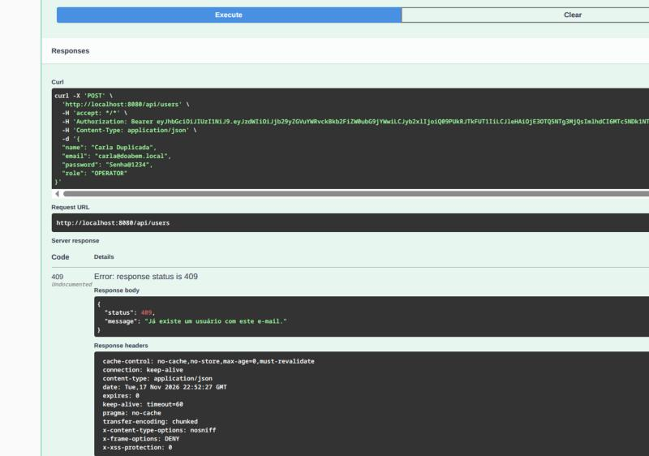

#### USR-04 · Aprovado

| Requisito / regra | Perfil | Status |
|---|---|---|
| RF05, RNF02 | Coord. | Aprovado |

- **Passos e dados de entrada:** Criar usuário com senha de 3 caracteres.
- **Resultado esperado:** HTTP 400: senha deve ter entre 8 e 72 caracteres.
- **Resultado obtido:** HTTP 400: A senha deve ter entre 8 e 72 caracteres.

**Evidência de USR-04:**

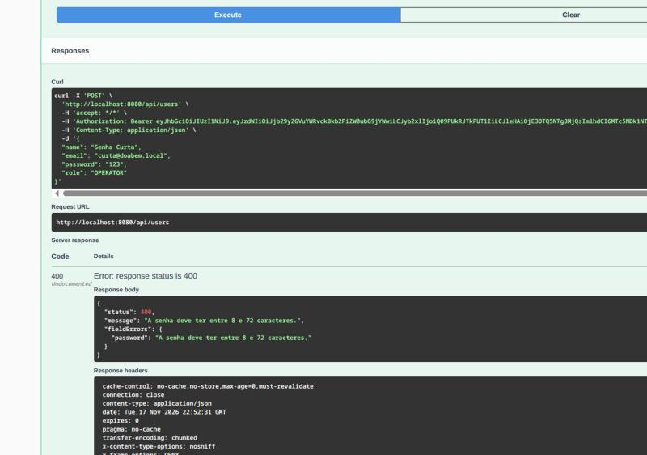

#### USR-05 · Aprovado

| Requisito / regra | Perfil | Status |
|---|---|---|
| RF05, RN27, CA08 | Oper. | Aprovado |

- **Passos e dados de entrada:** Operador tenta criar usuário por chamada direta à API.
- **Resultado esperado:** HTTP 403.
- **Resultado obtido:** HTTP 403 (Operador).

**Evidência de USR-05:**

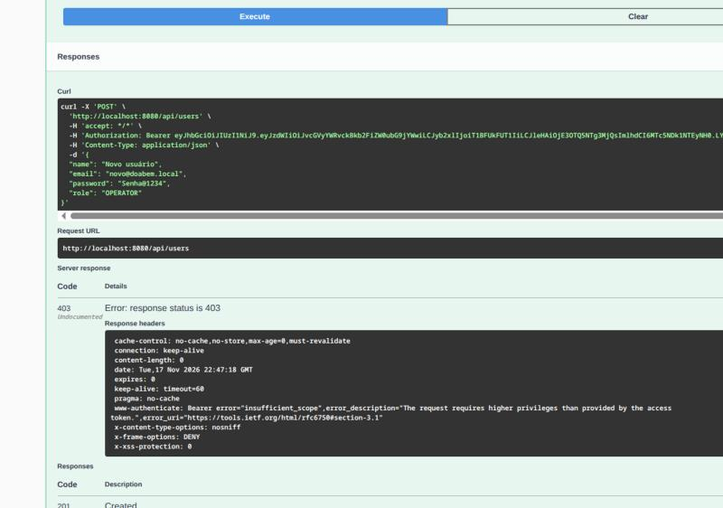

### 3. Categorias e itens

#### CAT-01 · Aprovado

| Requisito / regra | Perfil | Status |
|---|---|---|
| RF08 | Coord. | Aprovado |

- **Passos e dados de entrada:** POST /api/categories com nome e descrição.
- **Resultado esperado:** HTTP 201 e categoria ativa.
- **Resultado obtido:** HTTP 201; categoria criada e ativa.

**Evidência de CAT-01:**

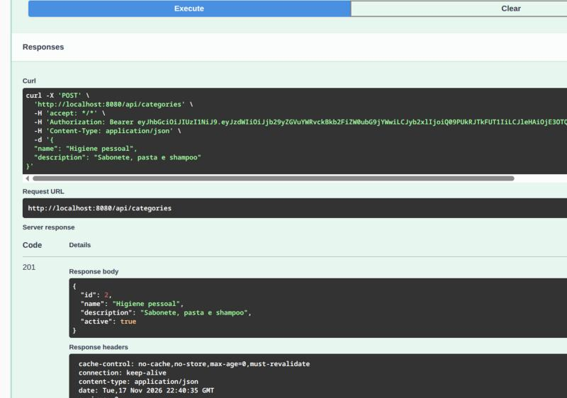

#### CAT-02 · Aprovado

| Requisito / regra | Perfil | Status |
|---|---|---|
| RF08 | Coord. | Aprovado |

- **Passos e dados de entrada:** Criar categoria com nome já existente.
- **Resultado esperado:** Recusa (400/409) com mensagem de duplicidade.
- **Resultado obtido:** HTTP 409: Já existe uma categoria com este nome.

**Evidência de CAT-02:**

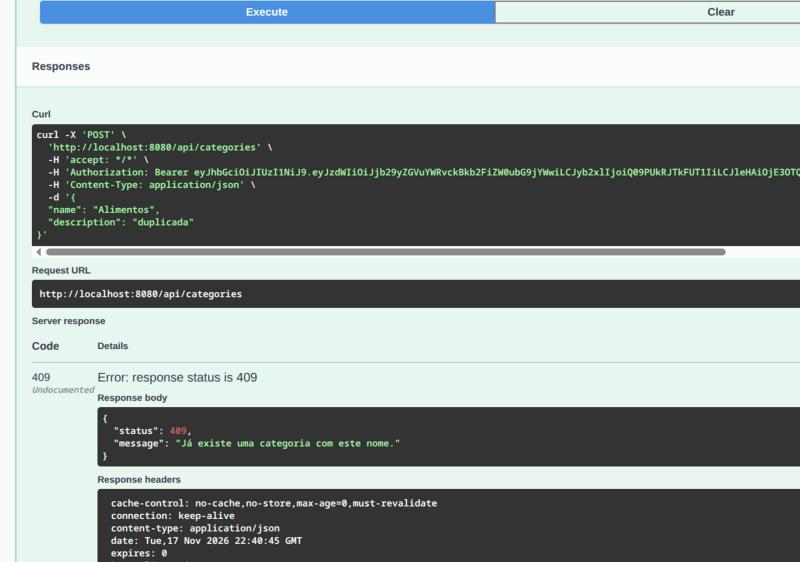

#### CAT-03 · Aprovado

| Requisito / regra | Perfil | Status |
|---|---|---|
| RF08 | Coord. | Aprovado |

- **Passos e dados de entrada:** Criar categoria com nome vazio.
- **Resultado esperado:** HTTP 400.
- **Resultado obtido:** HTTP 400: Informe o nome da categoria.

**Evidência de CAT-03:**

#### CAT-04 · Aprovado

| Requisito / regra | Perfil | Status |
|---|---|---|
| RF03, D-05 | Oper. | Aprovado |

- **Passos e dados de entrada:** Operador tenta criar categoria.
- **Resultado esperado:** HTTP 403 (cadastro exclusivo do Coordenador).
- **Resultado obtido:** HTTP 403 (Operador).

**Evidência de CAT-04:**

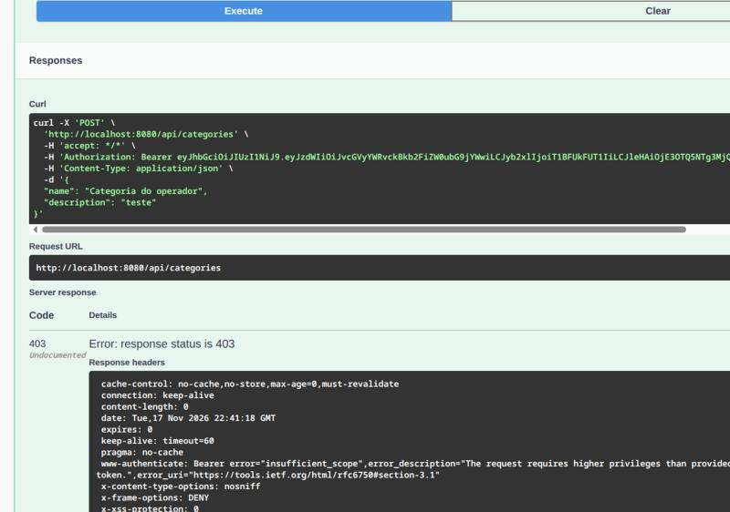

#### ITM-01 · Aprovado

| Requisito / regra | Perfil | Status |
|---|---|---|
| RF09, RN09 | Coord. | Aprovado |

- **Passos e dados de entrada:** Criar item em KG com estoque mínimo 10.
- **Resultado esperado:** HTTP 201; unidade KG e mínimo 10.
- **Resultado obtido:** HTTP 201; item KG, mínimo 10, ACTIVE.

**Evidência de ITM-01:**

#### ITM-02 · Aprovado

| Requisito / regra | Perfil | Status |
|---|---|---|
| RF09, RN09 | Coord. | Aprovado |

- **Passos e dados de entrada:** Criar item em UNIT com mínimo 5.
- **Resultado esperado:** HTTP 201.
- **Resultado obtido:** HTTP 201; item UNIT, mínimo 5, ACTIVE.

**Evidência de ITM-02:**

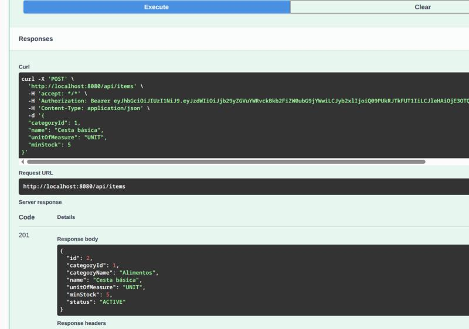

#### ITM-03 · Aprovado

| Requisito / regra | Perfil | Status |
|---|---|---|
| RF09, Q04 | Coord. | Aprovado |

- **Passos e dados de entrada:** Criar item em L com mínimo 0.
- **Resultado esperado:** HTTP 201 (mínimo 0 é permitido).
- **Resultado obtido:** HTTP 201; item em L, mínimo 0.

**Evidência de ITM-03:**

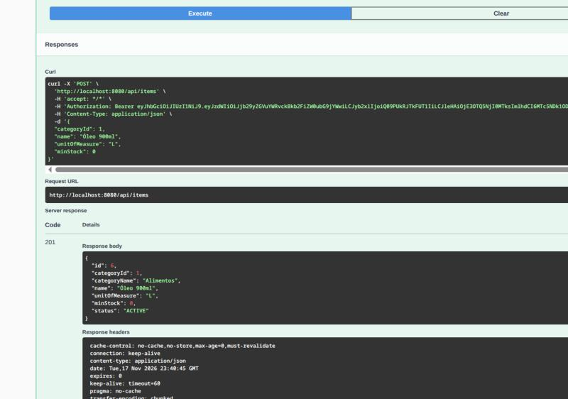

#### ITM-04 · Aprovado

| Requisito / regra | Perfil | Status |
|---|---|---|
| RF09, RN09 | Coord. | Aprovado |

- **Passos e dados de entrada:** Criar item sem unidade de medida.
- **Resultado esperado:** HTTP 400: unidade obrigatória.
- **Resultado obtido:** HTTP 400: Informe a unidade de medida (UNIT, KG ou L).

**Evidência de ITM-04:**

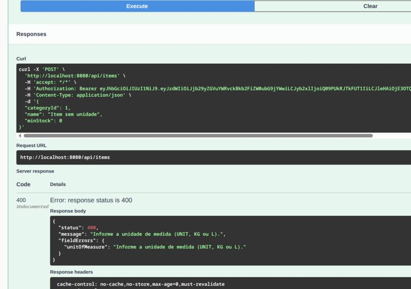

#### ITM-05 · Aprovado

| Requisito / regra | Perfil | Status |
|---|---|---|
| RF09 | Coord. | Aprovado |

- **Passos e dados de entrada:** Criar item com estoque mínimo negativo.
- **Resultado esperado:** HTTP 400.
- **Resultado obtido:** HTTP 400: O estoque mínimo não pode ser negativo.

**Evidência de ITM-05:**

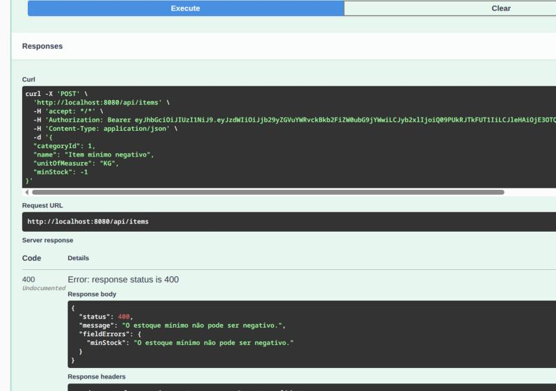

#### ITM-06 · Aprovado

| Requisito / regra | Perfil | Status |
|---|---|---|
| RF03, D-05 | Oper. | Aprovado |

- **Passos e dados de entrada:** Operador tenta criar item.
- **Resultado esperado:** HTTP 403.
- **Resultado obtido:** HTTP 403 (Operador).

**Evidência de ITM-06:**

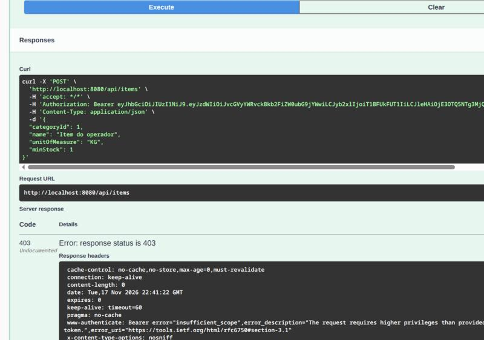

#### ITM-07 · Aprovado

| Requisito / regra | Perfil | Status |
|---|---|---|
| RF10, RN09 | Coord. | Aprovado |

- **Passos e dados de entrada:** Editar nome e mínimo do item.
- **Resultado esperado:** HTTP 200; a unidade de medida permanece inalterada.
- **Resultado obtido:** HTTP 200; nome e mínimo (12) atualizados; unidade KG inalterada.

**Evidência de ITM-07:**

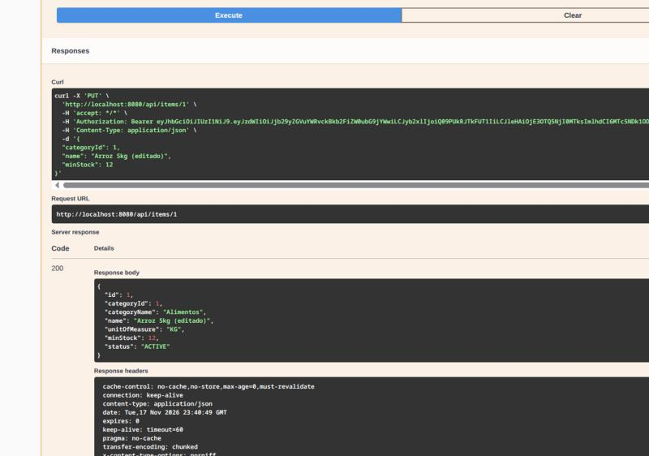

#### ITM-08 · Aprovado

| Requisito / regra | Perfil | Status |
|---|---|---|
| RF11 | Coord. | Aprovado |

- **Passos e dados de entrada:** Listar itens com filtro situação = Ativos.
- **Resultado esperado:** Somente itens ativos retornados.
- **Resultado obtido:** HTTP 200; a URL leva status=ACTIVE e a lista devolve itens ACTIVE.

**Evidência de ITM-08:**

#### ITM-09 · Aprovado

| Requisito / regra | Perfil | Status |
|---|---|---|
| RF10, D-07 | Coord. | Aprovado |

- **Passos e dados de entrada:** Inativar item sem reserva e com saldo positivo (13 un). Depois zerar o saldo por ajuste (13 un) e inativar de novo.
- **Resultado esperado:** Inativação bloqueada quando o item tem saldo (decisão do PO, D-07).
- **Resultado obtido:** 1º print: HTTP 409: O item ainda tem saldo em estoque. Zere o saldo por ajuste ou entrega antes de inativar. 2º print: depois de zerar o saldo por ajuste (13 → 0), HTTP 200 e item INACTIVE. Reexecutado após a correção do DEF-01.

**Evidência de ITM-09:**

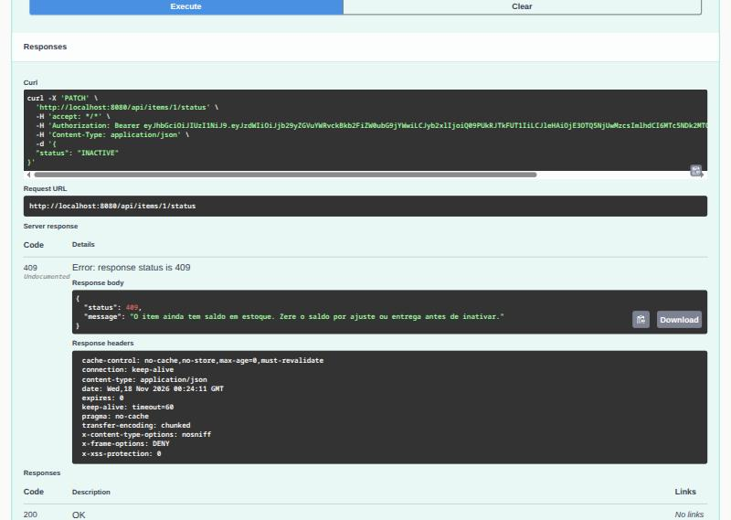

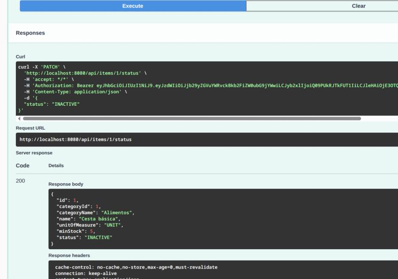

#### ITM-10 · Aprovado

| Requisito / regra | Perfil | Status |
|---|---|---|
| RN14, CA10 | Coord. | Aprovado |

- **Passos e dados de entrada:** Com o item inativo: nova entrada, ajuste e consulta de histórico.
- **Resultado esperado:** Entrada e ajuste recusados; histórico continua visível.
- **Resultado obtido:** 1º print (entrada): HTTP 422, item inativo não recebe entradas. 2º print (ajuste): HTTP 422, não recebe ajustes. 3º print (histórico): HTTP 200, as movimentações do item continuam visíveis.

**Evidência de ITM-10:**

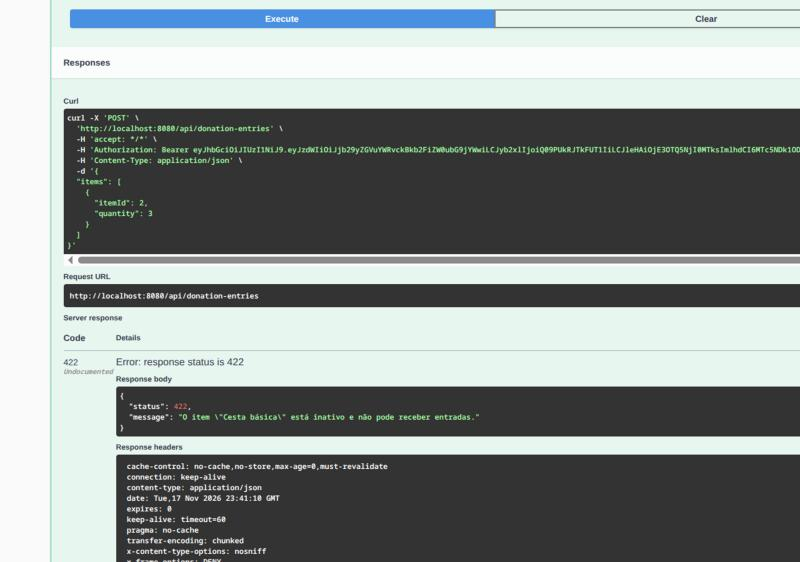

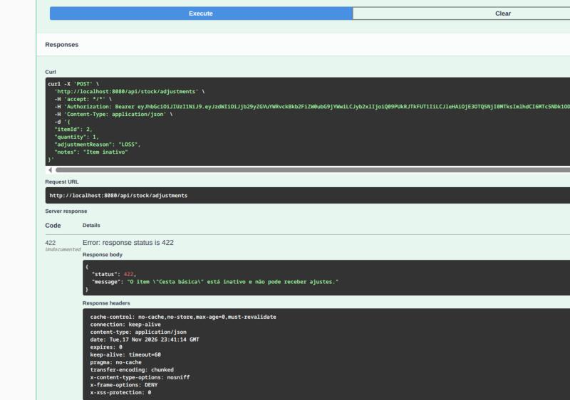

#### ITM-11 · Aprovado

| Requisito / regra | Perfil | Status |
|---|---|---|
| RF10, RN14, CA10 | Coord. | Aprovado |

- **Passos e dados de entrada:** Item com 10 un em estoque e 4 un reservadas (solicitação SEPARADA); PATCH /api/items/{id}/status = INACTIVE.
- **Resultado esperado:** Inativação bloqueada, com o motivo informado.
- **Resultado obtido:** HTTP 409: O item tem quantidade reservada em solicitação separada. Conclua ou cancele antes de inativar.

**Evidência de ITM-11:**

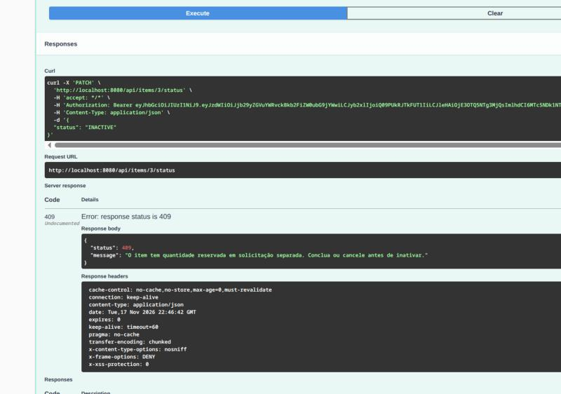

### 4. Entradas de doação

#### ENT-01 · Aprovado

| Requisito / regra | Perfil | Status |
|---|---|---|
| RF12, RF15, CA01 | Oper. | Aprovado |

- **Passos e dados de entrada:** Entrada com 80,5 kg (validade informativa) e 20 un na mesma requisição; depois consultar o estoque.
- **Resultado esperado:** HTTP 201; duas movimentações ENTRADA; saldos físicos sobem para 80,5 e 20.
- **Resultado obtido:** HTTP 201. O estoque (segundo print) mostra Arroz 5kg com saldo físico 80,5 (a Cesta básica já mostra 18 porque o ajuste AJU-01 foi feito antes dessa consulta).

**Evidência de ENT-01:**

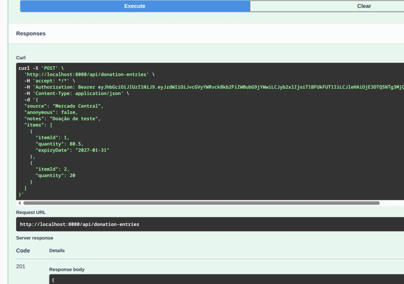

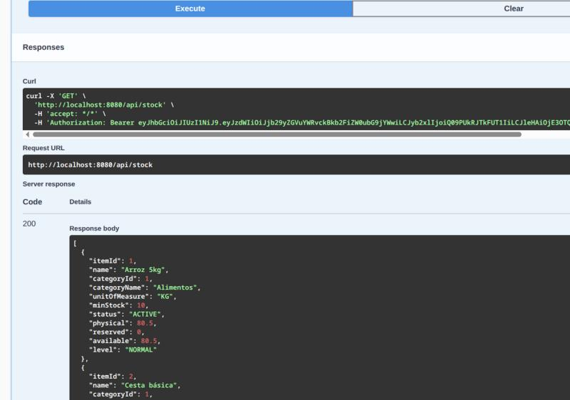

#### ENT-02 · Aprovado

| Requisito / regra | Perfil | Status |
|---|---|---|
| RF16 | Coord. | Aprovado |

- **Passos e dados de entrada:** Consultar o detalhe da entrada criada.
- **Resultado esperado:** HTTP 200 com origem, responsável, data e itens.
- **Resultado obtido:** HTTP 200; detalhe com origem, responsável (Operador Demo), data e itens.

**Evidência de ENT-02:**

#### ENT-03 · Aprovado

| Requisito / regra | Perfil | Status |
|---|---|---|
| RF15, RN10, RN23, CA01 | Coord. | Aprovado |

- **Passos e dados de entrada:** Entrada com linha válida (5 kg) e linha inválida (2,5 un).
- **Resultado esperado:** Recusada; nenhuma linha gravada (atomicidade). Saldo de KG inalterado.
- **Resultado obtido:** HTTP 422: itens em UNIT aceitam somente números inteiros. Nada gravado.

**Evidência de ENT-03:**

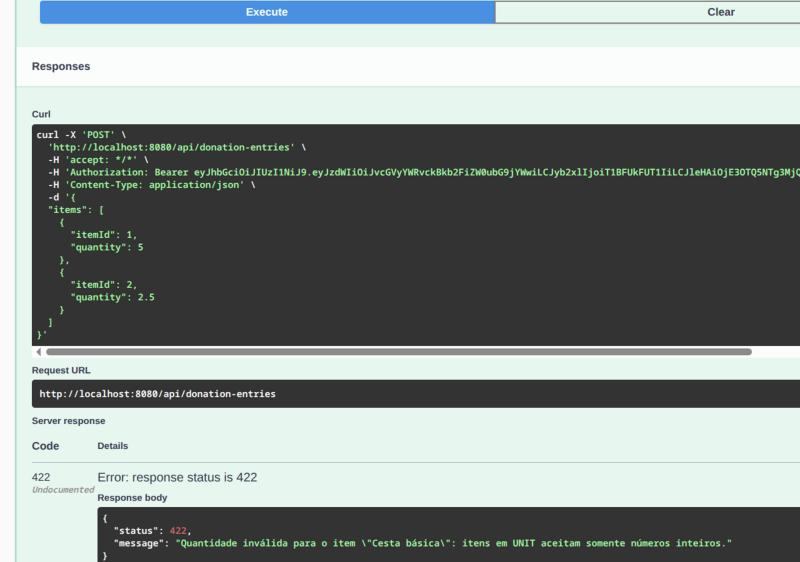

#### ENT-04 · Aprovado

| Requisito / regra | Perfil | Status |
|---|---|---|
| RF14, RN10 | Coord. | Aprovado |

- **Passos e dados de entrada:** Entrada com quantidade 0.
- **Resultado esperado:** HTTP 400.
- **Resultado obtido:** HTTP 400: A quantidade deve ser maior que zero.

**Evidência de ENT-04:**

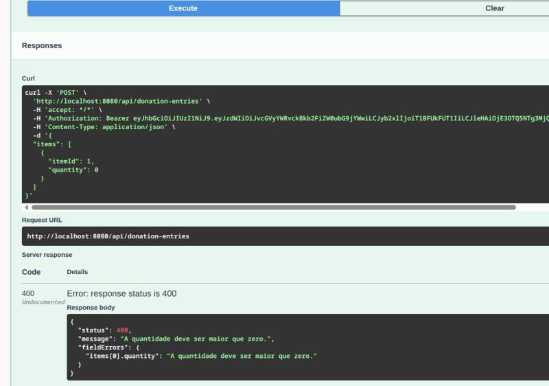

#### ENT-05 · Aprovado

| Requisito / regra | Perfil | Status |
|---|---|---|
| RF14, RN10 | Coord. | Aprovado |

- **Passos e dados de entrada:** Entrada com quantidade negativa.
- **Resultado esperado:** HTTP 400.
- **Resultado obtido:** HTTP 400: A quantidade deve ser maior que zero.

**Evidência de ENT-05:**

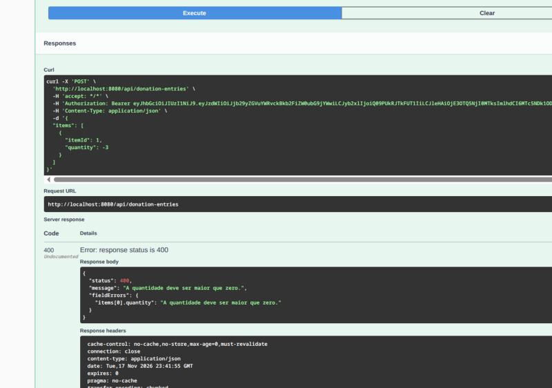

#### ENT-06 · Aprovado

| Requisito / regra | Perfil | Status |
|---|---|---|
| RF14, RN10 | Coord. | Aprovado |

- **Passos e dados de entrada:** Entrada de KG com 4 casas decimais (1,2345).
- **Resultado esperado:** HTTP 400 (máximo 3 casas).
- **Resultado obtido:** HTTP 400: A quantidade aceita até 3 casas decimais.

**Evidência de ENT-06:**

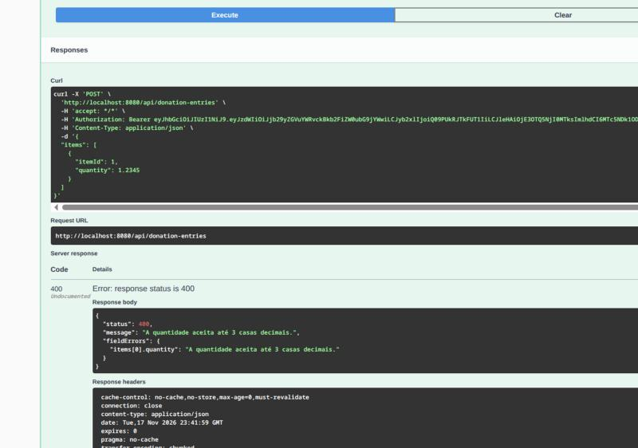

#### ENT-07 · Aprovado

| Requisito / regra | Perfil | Status |
|---|---|---|
| RF12 | Coord. | Aprovado |

- **Passos e dados de entrada:** Entrada sem nenhum item.
- **Resultado esperado:** HTTP 400.
- **Resultado obtido:** HTTP 400: Informe ao menos um item.

**Evidência de ENT-07:**

#### ENT-08 · Aprovado

| Requisito / regra | Perfil | Status |
|---|---|---|
| RF12, RN24, Q14 | Coord. | Aprovado |

- **Passos e dados de entrada:** Entrada marcada como anônima, informando uma origem.
- **Resultado esperado:** HTTP 201; origem ignorada (doação anônima).
- **Resultado obtido:** HTTP 201; doação anônima: source gravada como null (a origem informada foi ignorada).

**Evidência de ENT-08:**

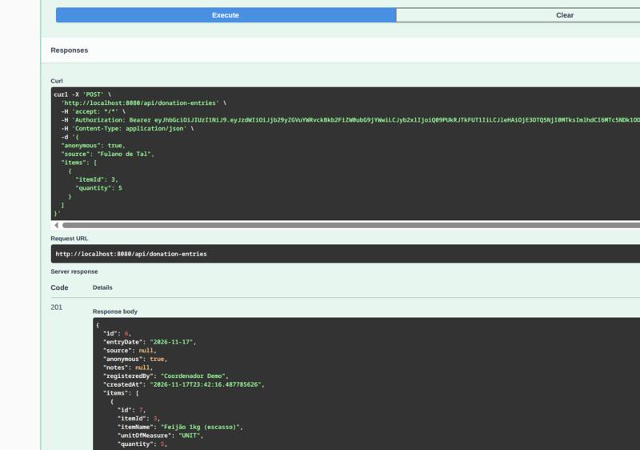

#### ENT-09 · Aprovado

| Requisito / regra | Perfil | Status |
|---|---|---|
| RF12 | Coord. | Aprovado |

- **Passos e dados de entrada:** Entrada com item inexistente.
- **Resultado esperado:** HTTP 404/400.
- **Resultado obtido:** HTTP 404: Item não encontrado.

**Evidência de ENT-09:**

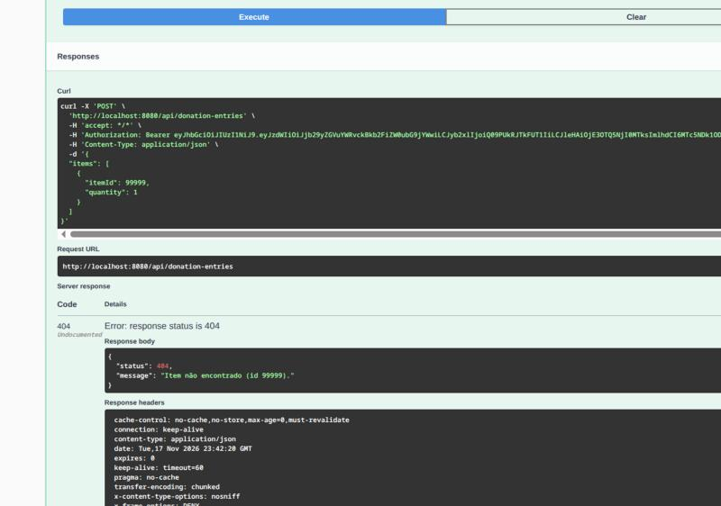

#### ENT-10 · Aprovado

| Requisito / regra | Perfil | Status |
|---|---|---|
| RF16 | Oper. | Aprovado |

- **Passos e dados de entrada:** Listar entradas.
- **Resultado esperado:** HTTP 200.
- **Resultado obtido:** HTTP 200; lista paginada de entradas.

**Evidência de ENT-10:**

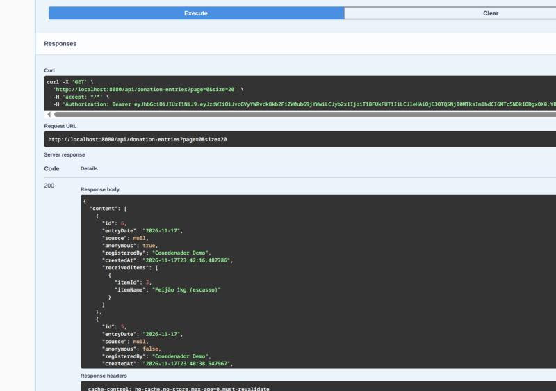

### 5. Estoque, saldo e ajustes

#### AJU-01 · Aprovado

| Requisito / regra | Perfil | Status |
|---|---|---|
| RF19, RN13, CA07 | Coord. | Aprovado |

- **Passos e dados de entrada:** Ajuste por avaria de 2 un com observação.
- **Resultado esperado:** HTTP 201; saldo baixa de 20 para 18; movimentação AJUSTE.
- **Resultado obtido:** HTTP 201; movimentação ADJUSTMENT de 2 un, motivo DAMAGE.

**Evidência de AJU-01:**

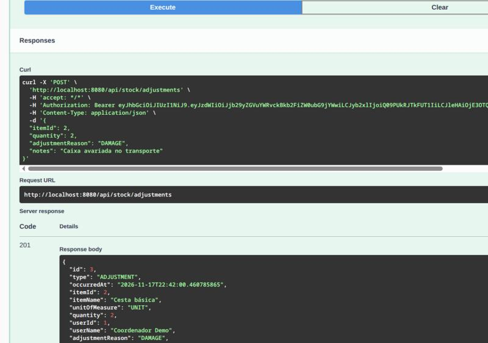

#### AJU-02 · Aprovado

| Requisito / regra | Perfil | Status |
|---|---|---|
| RN01, RF19 | Coord. | Aprovado |

- **Passos e dados de entrada:** Ajuste de 999 un com saldo de 18 un.
- **Resultado esperado:** Recusado; saldo permanece 18 (nunca negativo).
- **Resultado obtido:** HTTP 422: Saldo disponível insuficiente: há 18 un. O estoque não pode ficar negativo.

**Evidência de AJU-02:**

#### AJU-03 · Aprovado

| Requisito / regra | Perfil | Status |
|---|---|---|
| RF19 | Coord. | Aprovado |

- **Passos e dados de entrada:** Ajuste sem observação.
- **Resultado esperado:** HTTP 400.
- **Resultado obtido:** HTTP 400: Informe uma observação.

**Evidência de AJU-03:**

#### AJU-04 · Aprovado

| Requisito / regra | Perfil | Status |
|---|---|---|
| RF03, RN13, CA08 | Oper. | Aprovado |

- **Passos e dados de entrada:** Operador tenta registrar ajuste.
- **Resultado esperado:** HTTP 403.
- **Resultado obtido:** HTTP 403 (Operador).

**Evidência de AJU-04:**

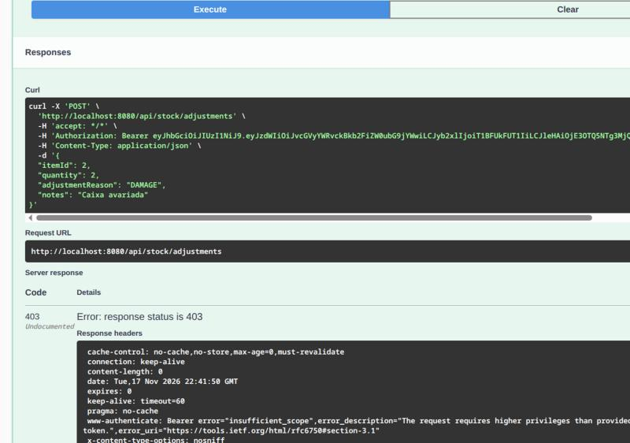

#### AJU-05 · Aprovado

| Requisito / regra | Perfil | Status |
|---|---|---|
| RF14, RN10 | Coord. | Aprovado |

- **Passos e dados de entrada:** Ajuste de 1,5 un em item UNIT.
- **Resultado esperado:** Recusado; saldo inalterado.
- **Resultado obtido:** HTTP 422: itens em UNIT aceitam somente números inteiros.

**Evidência de AJU-05:**

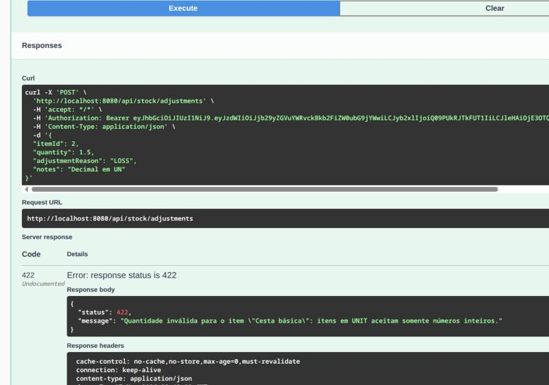

#### EST-01 · Aprovado

| Requisito / regra | Perfil | Status |
|---|---|---|
| RF18, RN11, CA11 | Coord. | Aprovado |

- **Passos e dados de entrada:** Item com mínimo 10: saldo 10 e depois saldo 15.
- **Resultado esperado:** Saldo 10 aparece como CRÍTICO (≤ mínimo); saldo 15 deixa de ser crítico.
- **Resultado obtido:** 1º print: saldo 10 com mínimo 10, level CRITICAL. 2º print: após nova entrada de 5, saldo 15, level LOW (deixa de ser crítico).

**Evidência de EST-01:**

### 6. Famílias/beneficiários

#### FAM-01 · Aprovado

| Requisito / regra | Perfil | Status |
|---|---|---|
| RF22 | Oper. | Aprovado |

- **Passos e dados de entrada:** Cadastrar família com responsável, telefone, bairro e 4 integrantes.
- **Resultado esperado:** HTTP 201 e família ativa.
- **Resultado obtido:** HTTP 201; família criada e ACTIVE.

**Evidência de FAM-01:**

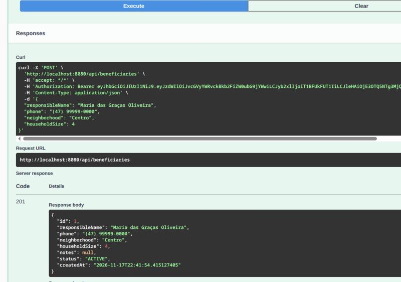

#### FAM-02 · Aprovado

| Requisito / regra | Perfil | Status |
|---|---|---|
| RF22 | Coord. | Aprovado |

- **Passos e dados de entrada:** Cadastrar família com 0 integrantes.
- **Resultado esperado:** HTTP 400 (mínimo 1).
- **Resultado obtido:** HTTP 400: O número de integrantes deve ser pelo menos 1.

**Evidência de FAM-02:**

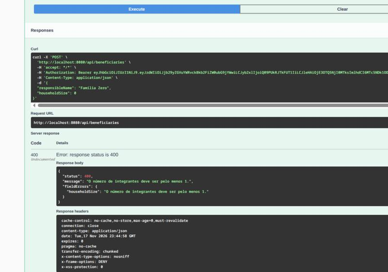

#### FAM-03 · Aprovado

| Requisito / regra | Perfil | Status |
|---|---|---|
| RF22 | Coord. | Aprovado |

- **Passos e dados de entrada:** Cadastrar família sem nome do responsável.
- **Resultado esperado:** HTTP 400.
- **Resultado obtido:** HTTP 400: Informe o nome do responsável.

**Evidência de FAM-03:**

#### FAM-04 · Aprovado

| Requisito / regra | Perfil | Status |
|---|---|---|
| RF23 | Oper. | Aprovado |

- **Passos e dados de entrada:** Editar família.
- **Resultado esperado:** HTTP 200.
- **Resultado obtido:** HTTP 200; família atualizada (telefone e nº de integrantes).

**Evidência de FAM-04:**

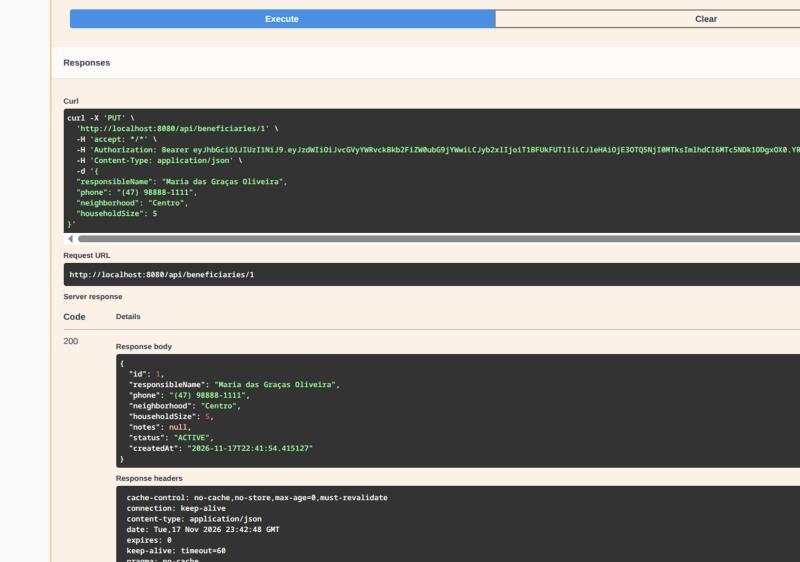

#### FAM-05 · Aprovado

| Requisito / regra | Perfil | Status |
|---|---|---|
| RF25 | Oper. | Aprovado |

- **Passos e dados de entrada:** Consultar resumo de entregas da família.
- **Resultado esperado:** HTTP 200 com última entrega e entregas recentes.
- **Resultado obtido:** HTTP 200; resumo traz a última entrega (solicitação #2) e as recentes.

**Evidência de FAM-05:**

#### FAM-06 · Aprovado

| Requisito / regra | Perfil | Status |
|---|---|---|
| RN08, RNF02 | Sem login | Aprovado |

- **Passos e dados de entrada:** Listar famílias sem token.
- **Resultado esperado:** HTTP 401/403 (dados protegidos).
- **Resultado obtido:** HTTP 401 (sem token, rota protegida).

**Evidência de FAM-06:**

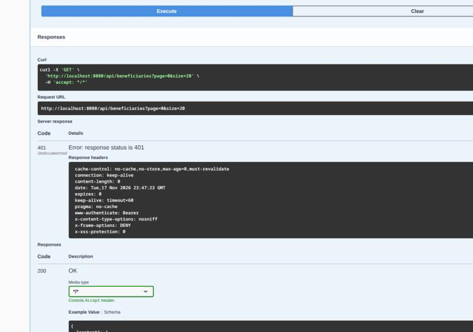

#### FAM-07 · Aprovado

| Requisito / regra | Perfil | Status |
|---|---|---|
| RF23, RN15 | Coord. | Aprovado |

- **Passos e dados de entrada:** Inativar família sem pendências e criar solicitação para ela.
- **Resultado esperado:** Inativação OK; nova solicitação recusada (somente famílias ativas).
- **Resultado obtido:** 1º print: inativar família sem pendências, HTTP 200 (INACTIVE). 2º print: nova solicitação para ela, HTTP 400: Somente famílias ativas recebem novas solicitações.

**Evidência de FAM-07:**

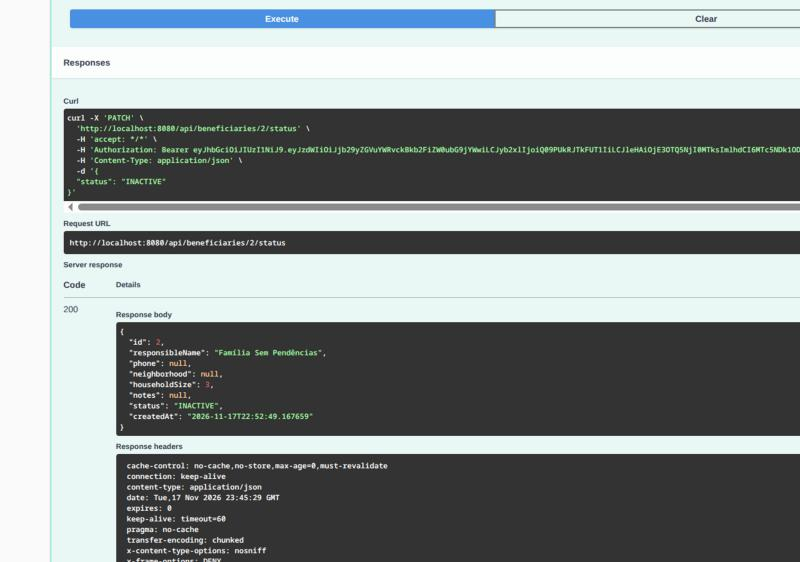

#### FAM-08 · Aprovado

| Requisito / regra | Perfil | Status |
|---|---|---|
| RF23, D-09 | Coord. | Aprovado |

- **Passos e dados de entrada:** Inativar família que tem solicitação PENDENTE.
- **Resultado esperado:** Inativação bloqueada com solicitação em andamento (decisão do PO, D-09).
- **Resultado obtido:** HTTP 422: A família tem solicitação em andamento. Conclua ou cancele antes de inativar.

**Evidência de FAM-08:**

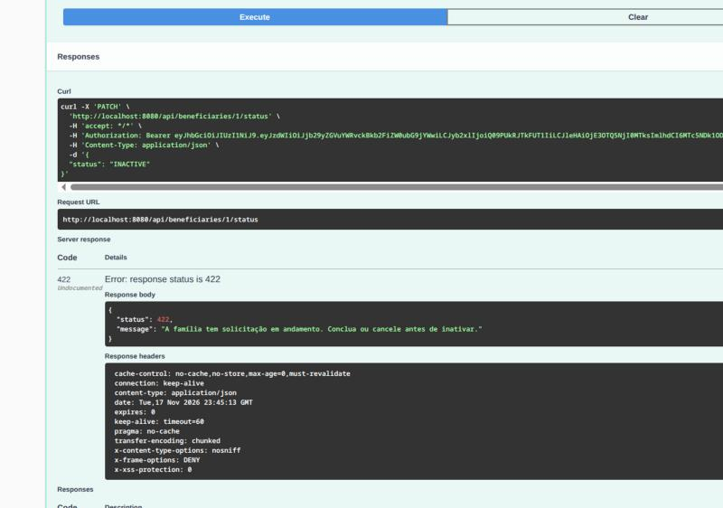

### 7. Solicitação, separação e entrega

#### SOL-01 · Aprovado

| Requisito / regra | Perfil | Status |
|---|---|---|
| RF26, RN17 | Oper. | Aprovado |

- **Passos e dados de entrada:** Criar solicitação para família ativa com 2 itens.
- **Resultado esperado:** HTTP 201, estado PENDENTE; nenhum estoque reservado.
- **Resultado obtido:** HTTP 201; solicitação #1 em PENDING.

**Evidência de SOL-01:**

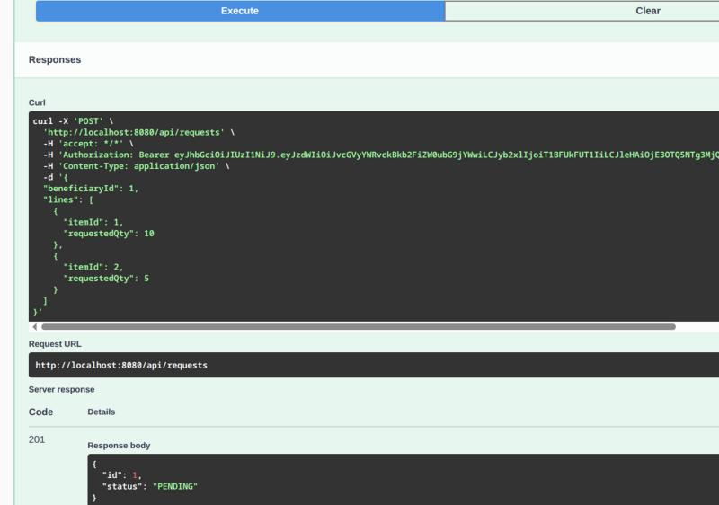

#### SOL-02 · Aprovado

| Requisito / regra | Perfil | Status |
|---|---|---|
| RF27 | Oper. | Aprovado |

- **Passos e dados de entrada:** Consultar detalhe da solicitação.
- **Resultado esperado:** HTTP 200, estado PENDENTE e itens.
- **Resultado obtido:** HTTP 200; detalhe da solicitação #6 em PENDING, com família e itens.

**Evidência de SOL-02:**

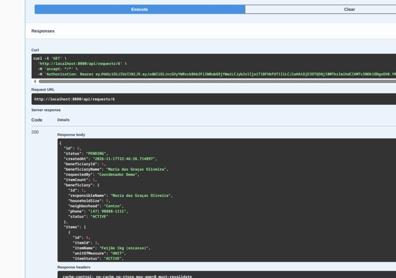

#### SOL-03 · Aprovado

| Requisito / regra | Perfil | Status |
|---|---|---|
| RF28, RF29, CA08 | Oper. | Aprovado |

- **Passos e dados de entrada:** Operador tenta aprovar.
- **Resultado esperado:** HTTP 403.
- **Resultado obtido:** HTTP 403 (Operador tentando aprovar).

**Evidência de SOL-03:**

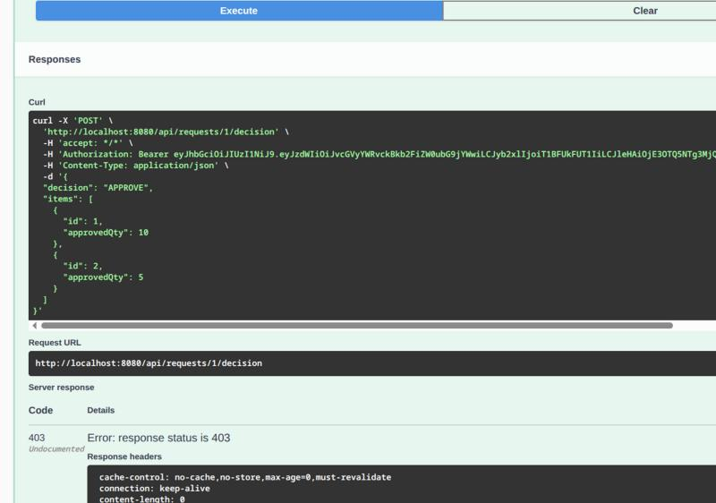

#### SOL-04 · Aprovado

| Requisito / regra | Perfil | Status |
|---|---|---|
| RF28, RN16, CA02 | Coord. | Aprovado |

- **Passos e dados de entrada:** Aprovar 6 de 10 kg sem justificativa.
- **Resultado esperado:** HTTP 400: justificativa obrigatória.
- **Resultado obtido:** HTTP 400: Informe a justificativa da aprovação parcial.

**Evidência de SOL-04:**

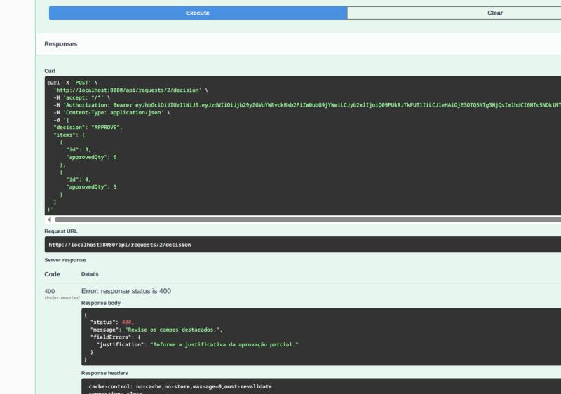

#### SOL-05 · Aprovado

| Requisito / regra | Perfil | Status |
|---|---|---|
| RN16, CA02 | Coord. | Aprovado |

- **Passos e dados de entrada:** Aprovar 11 kg quando foram solicitados 10.
- **Resultado esperado:** HTTP 400: aprovado não pode exceder o solicitado.
- **Resultado obtido:** HTTP 400: O aprovado não pode exceder o solicitado.

**Evidência de SOL-05:**

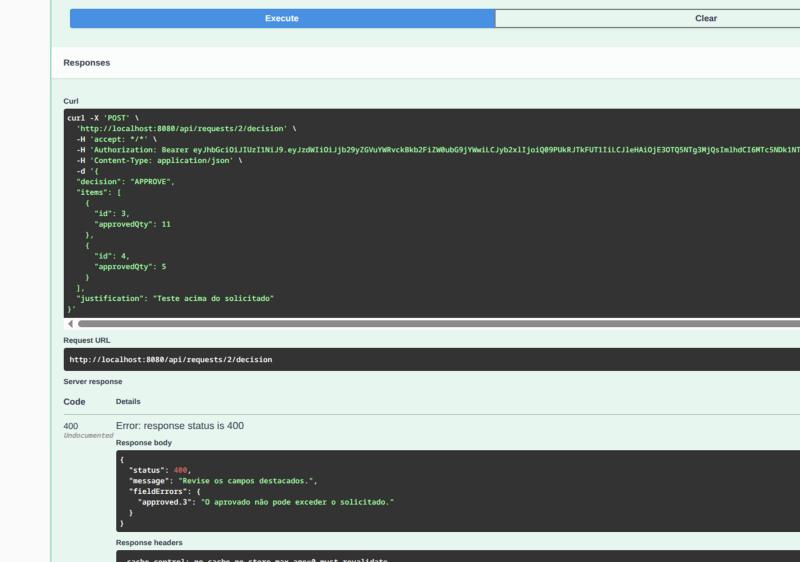

#### SOL-06 · Aprovado

| Requisito / regra | Perfil | Status |
|---|---|---|
| RF28, RN17, CA02 | Coord. | Aprovado |

- **Passos e dados de entrada:** Aprovar parcialmente (6 kg) com justificativa.
- **Resultado esperado:** Estado APROVADA; saldo físico e reservado não mudam.
- **Resultado obtido:** HTTP 200; status APPROVED.

**Evidência de SOL-06:**

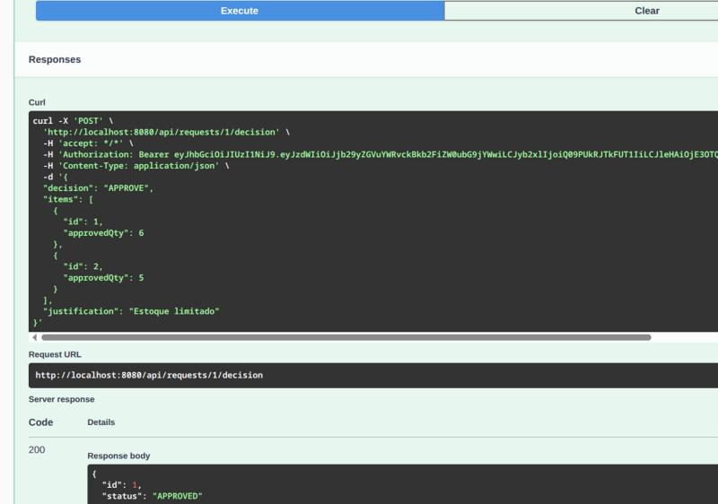

#### SOL-07 · Aprovado

| Requisito / regra | Perfil | Status |
|---|---|---|
| RF30, RN04, CA04 | Oper. | Aprovado |

- **Passos e dados de entrada:** Separar a solicitação aprovada (físico 80,5 kg).
- **Resultado esperado:** Estado SEPARADA; reservado 6; disponível 74,5; físico inalterado.
- **Resultado obtido:** HTTP 200; status PICKED. Segundo print (estoque): Arroz 5kg com físico 80,5, reservado 6, disponível 74,5.

**Evidência de SOL-07:**

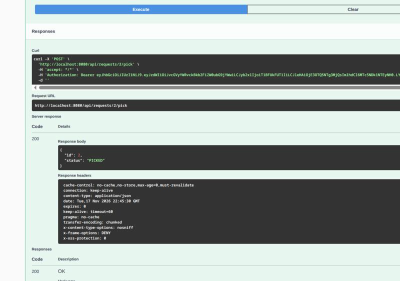

#### SOL-08 · Aprovado

| Requisito / regra | Perfil | Status |
|---|---|---|
| RF31, RN05, CA05 | Oper. | Aprovado |

- **Passos e dados de entrada:** Confirmar a entrega com observação.
- **Resultado esperado:** Estado ENTREGUE; reserva consumida; físico baixa para 74,5; reservado 0.
- **Resultado obtido:** HTTP 200; status DELIVERED. Segundo print (estoque): Arroz 5kg com físico 74,5 e reservado 0.

**Evidência de SOL-08:**

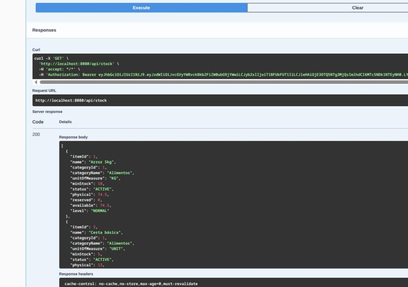

#### SOL-09 · Aprovado

| Requisito / regra | Perfil | Status |
|---|---|---|
| RN20 | Oper. | Aprovado |

- **Passos e dados de entrada:** Confirmar a entrega pela segunda vez.
- **Resultado esperado:** Recusada (somente solicitações separadas podem ser entregues).
- **Resultado obtido:** HTTP 409: Somente solicitações separadas podem ser entregues.

**Evidência de SOL-09:**

#### SOL-10 · Aprovado

| Requisito / regra | Perfil | Status |
|---|---|---|
| RN19, CA06 | Coord. | Aprovado |

- **Passos e dados de entrada:** Cancelar solicitação já entregue.
- **Resultado esperado:** Recusado (409/400/422).
- **Resultado obtido:** HTTP 409: Esta solicitação não pode mais ser cancelada.

**Evidência de SOL-10:**

#### SOL-11 · Aprovado

| Requisito / regra | Perfil | Status |
|---|---|---|
| RF34, RN05 | Oper. | Aprovado |

- **Passos e dados de entrada:** Consultar o comprovante digital da entrega.
- **Resultado esperado:** Detalhe traz entrega com responsável e data/hora.
- **Resultado obtido:** HTTP 200; solicitação #2 em DELIVERED, com a entrega registrada (responsável e data/hora no corpo da resposta).

**Evidência de SOL-11:**

#### SOL-12 · Aprovado

| Requisito / regra | Perfil | Status |
|---|---|---|
| RF30, RN01, RN04, CA03 | Coord. | Aprovado |

- **Passos e dados de entrada:** Solicitação APROVADA de 30 un para item com 20 un em estoque e 8 reservadas (disponível 12); tentar separar.
- **Resultado esperado:** Separação bloqueada; nenhuma reserva criada; mensagem orienta revisar a solicitação.
- **Resultado obtido:** HTTP 422: Saldo insuficiente para separar... aprovado 30 un, disponível 12 un. Nenhuma reserva foi feita.

**Evidência de SOL-12:**

#### SOL-13 · Aprovado

| Requisito / regra | Perfil | Status |
|---|---|---|
| RF33, RN06, CA06 | Oper. | Aprovado |

- **Passos e dados de entrada:** Separar 8 un e cancelar a separação com motivo.
- **Resultado esperado:** Estado CANCELADA; reservas liberadas.
- **Resultado obtido:** HTTP 200; status CANCELLED. A liberação da reserva foi conferida no estoque na execução por script (disponível voltou a 20).

**Evidência de SOL-13:**

#### SOL-14 · Aprovado

| Requisito / regra | Perfil | Status |
|---|---|---|
| RF33, RN19, CA06 | Coord. | Aprovado |

- **Passos e dados de entrada:** Cancelar sem informar o motivo.
- **Resultado esperado:** HTTP 400.
- **Resultado obtido:** HTTP 400: Informe o motivo.

**Evidência de SOL-14:**

#### SOL-15 · Aprovado

| Requisito / regra | Perfil | Status |
|---|---|---|
| RF28, RN16 | Coord. | Aprovado |

- **Passos e dados de entrada:** Recusar sem justificativa.
- **Resultado esperado:** HTTP 400.
- **Resultado obtido:** HTTP 400: Informe a justificativa.

**Evidência de SOL-15:**

#### SOL-16 · Aprovado

| Requisito / regra | Perfil | Status |
|---|---|---|
| RF28 | Coord. | Aprovado |

- **Passos e dados de entrada:** Recusar com justificativa.
- **Resultado esperado:** Estado RECUSADA.
- **Resultado obtido:** HTTP 200; status REJECTED.

**Evidência de SOL-16:**

#### SOL-17 · Aprovado

| Requisito / regra | Perfil | Status |
|---|---|---|
| RF26 | Coord. | Aprovado |

- **Passos e dados de entrada:** Criar solicitação com quantidade 0.
- **Resultado esperado:** HTTP 400.
- **Resultado obtido:** HTTP 400: A quantidade deve ser maior que zero.

**Evidência de SOL-17:**

#### SOL-18 · Aprovado

| Requisito / regra | Perfil | Status |
|---|---|---|
| RF26 | Coord. | Aprovado |

- **Passos e dados de entrada:** Criar solicitação sem itens.
- **Resultado esperado:** HTTP 400.
- **Resultado obtido:** HTTP 400: Adicione pelo menos um item.

**Evidência de SOL-18:**

#### SOL-19 · Aprovado

| Requisito / regra | Perfil | Status |
|---|---|---|
| RN14, RN15 | Coord. | Aprovado |

- **Passos e dados de entrada:** Criar solicitação com item inativo.
- **Resultado esperado:** Recusada (somente itens ativos).
- **Resultado obtido:** HTTP 400: Escolha um item ativo.

**Evidência de SOL-19:**

#### SOL-20 · Aprovado

| Requisito / regra | Perfil | Status |
|---|---|---|
| RF26 | Coord. | Aprovado |

- **Passos e dados de entrada:** Criar solicitação para família inexistente.
- **Resultado esperado:** HTTP 404/400.
- **Resultado obtido:** HTTP 404: Família não encontrada.

**Evidência de SOL-20:**

#### SOL-21 · Aprovado

| Requisito / regra | Perfil | Status |
|---|---|---|
| RN18 | Oper. | Aprovado |

- **Passos e dados de entrada:** Separar solicitação ainda PENDENTE (sem aprovar).
- **Resultado esperado:** Recusado: transição de estado inválida.
- **Resultado obtido:** HTTP 409: Somente solicitações aprovadas podem ser separadas.

**Evidência de SOL-21:**

#### SOL-22 · Aprovado

| Requisito / regra | Perfil | Status |
|---|---|---|
| RF33, D-04 | Oper. | Aprovado |

- **Passos e dados de entrada:** Operador cancela solicitação PENDENTE.
- **Resultado esperado:** HTTP 403: Operador não cancela PENDENTE; só o Coordenador cancela PENDENTE e APROVADA (decisão do PO, D-04).
- **Resultado obtido:** HTTP 403: o Operador não cancela solicitação PENDING.

**Evidência de SOL-22:**

### 8. Estorno

#### EXT-01 · Aprovado

| Requisito / regra | Perfil | Status |
|---|---|---|
| RF21, RN22, CA07 | Oper. | Aprovado |

- **Passos e dados de entrada:** Operador tenta estornar uma entrada.
- **Resultado esperado:** HTTP 403.
- **Resultado obtido:** HTTP 403 (Operador).

**Evidência de EXT-01:**

#### EXT-02 · Aprovado

| Requisito / regra | Perfil | Status |
|---|---|---|
| RF21, RN22, CA07 | Coord. | Aprovado |

- **Passos e dados de entrada:** Estornar sem justificativa.
- **Resultado esperado:** HTTP 400.
- **Resultado obtido:** HTTP 400: Informe a justificativa.

**Evidência de EXT-02:**

#### EXT-03 · Aprovado

| Requisito / regra | Perfil | Status |
|---|---|---|
| RN01, RN22, CA07 | Coord. | Aprovado |

- **Passos e dados de entrada:** Estornar entrada de 80,5 kg com saldo de 74,5 kg.
- **Resultado esperado:** Recusado por saldo insuficiente; saldo inalterado.
- **Resultado obtido:** HTTP 422: Saldo disponível insuficiente: há 74.5 kg. O estoque não pode ficar negativo.

**Evidência de EXT-03:**

#### EXT-04 · Aprovado

| Requisito / regra | Perfil | Status |
|---|---|---|
| RF21, RN07, CA07 | Coord. | Aprovado |

- **Passos e dados de entrada:** Estornar entrada de 7 un (saldo suficiente) com justificativa.
- **Resultado esperado:** Cria movimentação de ESTORNO; saldo volta a 0.
- **Resultado obtido:** HTTP 201; movimentação REVERSAL vinculada ao lançamento original (reversesId = 11).

**Evidência de EXT-04:**

#### EXT-05 · Aprovado

| Requisito / regra | Perfil | Status |
|---|---|---|
| RF21, RN22, CA07 | Coord. | Aprovado |

- **Passos e dados de entrada:** Estornar novamente o mesmo lançamento.
- **Resultado esperado:** Recusado (estorno duplo).
- **Resultado obtido:** HTTP 409: Este lançamento já foi estornado.

**Evidência de EXT-05:**

#### EXT-06 · Aprovado

| Requisito / regra | Perfil | Status |
|---|---|---|
| RF21 | Coord. | Aprovado |

- **Passos e dados de entrada:** Consultar o lançamento original após o estorno.
- **Resultado esperado:** Original mostra o vínculo com a movimentação compensatória.
- **Resultado obtido:** HTTP 200; o lançamento original (ENTRY #11) mostra reversedById = 14 e os dados do estorno.

**Evidência de EXT-06:**

#### EXT-07 · Aprovado

| Requisito / regra | Perfil | Status |
|---|---|---|
| D-03 | Coord. | Aprovado |

- **Passos e dados de entrada:** Estornar um estorno.
- **Resultado esperado:** Recusado: entradas, entregas e ajustes podem ser estornados, mas não o estorno (decisão do PO, D-03).
- **Resultado obtido:** HTTP 409: Somente entradas, entregas e ajustes podem ser estornados.

**Evidência de EXT-07:**

### 9. Históricos e dashboard

#### HIS-01 · Aprovado

| Requisito / regra | Perfil | Status |
|---|---|---|
| RF20, CA09 | Oper. | Aprovado |

- **Passos e dados de entrada:** Histórico de movimentações filtrado por item.
- **Resultado esperado:** Mostra entradas e saídas por entrega do item.
- **Resultado obtido:** HTTP 200; histórico do Arroz com a entrada e a saída por entrega.

**Evidência de HIS-01:**

#### HIS-02 · Aprovado

| Requisito / regra | Perfil | Status |
|---|---|---|
| RF20, Q22 | Coord. | Aprovado |

- **Passos e dados de entrada:** Filtrar movimentações por tipo = Ajuste.
- **Resultado esperado:** Somente movimentações de ajuste.
- **Resultado obtido:** HTTP 200; lista somente movimentações ADJUSTMENT.

**Evidência de HIS-02:**

#### HIS-03 · Aprovado

| Requisito / regra | Perfil | Status |
|---|---|---|
| RF20 | Coord. | Aprovado |

- **Passos e dados de entrada:** Filtrar por período sem dados (2099).
- **Resultado esperado:** HTTP 200, lista vazia.
- **Resultado obtido:** HTTP 200; content vazio (totalElements 0).

**Evidência de HIS-03:**

#### HIS-04 · Aprovado

| Requisito / regra | Perfil | Status |
|---|---|---|
| RF24, CA09 | Oper. | Aprovado |

- **Passos e dados de entrada:** Histórico de solicitações da família.
- **Resultado esperado:** HTTP 200 com solicitações, estados e responsáveis.
- **Resultado obtido:** HTTP 200; solicitações da família com estado e responsável.

**Evidência de HIS-04:**

#### DSH-01 · Aprovado

| Requisito / regra | Perfil | Status |
|---|---|---|
| RF35 | Oper. | Aprovado |

- **Passos e dados de entrada:** Consultar o dashboard.
- **Resultado esperado:** Devolve os 6 indicadores, gráficos e listas.
- **Resultado obtido:** HTTP 200; indicadores: 4 itens ativos, 1 crítico, 3 entradas, 1 entrega, 1 pendente e lista dos mais críticos.

**Evidência de DSH-01:**

#### DSH-02 · Aprovado

| Requisito / regra | Perfil | Status |
|---|---|---|
| RF35, RN29, CA09 | Coord. | Aprovado |

- **Passos e dados de entrada:** Comparar dashboard com estoque e lista de solicitações.
- **Resultado esperado:** Itens críticos, pendentes e itens ativos batem com as demais telas.
- **Resultado obtido:** Lista de solicitações PENDING com totalElements 1, igual ao pendingRequests = 1 do dashboard (print de DSH-01).

**Evidência de DSH-02:**

#### DSH-03 · Aprovado

| Requisito / regra | Perfil | Status |
|---|---|---|
| RF35 | Oper. | Aprovado |

- **Passos e dados de entrada:** Verificar a lista dos itens mais críticos.
- **Resultado esperado:** No máximo 5 itens, com saldo e mínimo.
- **Resultado obtido:** topCritical do dashboard (mesmo print do DSH-01): no máximo 5 itens, com saldo e mínimo.

**Evidência de DSH-03:**

#### DSH-04 · Aprovado

| Requisito / regra | Perfil | Status |
|---|---|---|
| RF36, RN29 | Coord. | Aprovado |

- **Passos e dados de entrada:** Dashboard com período futuro (jan/2099).
- **Resultado esperado:** Entradas e entregas = 0; críticos e pendentes continuam atuais.
- **Resultado obtido:** entriesInPeriod 0 e deliveriesInPeriod 0 no período futuro; criticalItems 2 e pendingRequests 1 continuam os valores atuais.

**Evidência de DSH-04:**

### 10. Requisitos não funcionais

#### NFR-01 · Aprovado

| Requisito / regra | Perfil | Status |
|---|---|---|
| RNF09 | Público | Aprovado |

- **Passos e dados de entrada:** Acessar /v3/api-docs e /swagger-ui.html.
- **Resultado esperado:** Informativo: documentação OpenAPI disponível no perfil de desenvolvimento.
- **Resultado obtido:** Swagger UI DoaBem API (OAS 3.1) abre em /swagger-ui/index.html e /v3/api-docs responde 200.

**Evidência de NFR-01:**

#### NFR-02 · Aprovado

| Requisito / regra | Perfil | Status |
|---|---|---|
| RNF06, RNF08 | Coord. | Aprovado |

- **Passos e dados de entrada:** Enviar item sem campos obrigatórios.
- **Resultado esperado:** HTTP 400 com erros por campo, em formato padronizado.
- **Resultado obtido:** HTTP 400 com fieldErrors (name e unitOfMeasure), formato padronizado.

**Evidência de NFR-02:**

### 11. Execução pela interface (tela)

#### UI-01 · Aprovado

| Requisito / regra | Perfil | Status |
|---|---|---|
| RF01 | Público | Aprovado |

- **Passos e dados de entrada:** Tela de login: e-mail do Coordenador e senha errada; clicar em Entrar.
- **Resultado esperado:** Mensagem clara de credencial inválida; permanece no login.
- **Resultado obtido:** E-mail ou senha inválidos. Tente novamente. exibido sob o campo de senha.

**Evidência de UI-01:**

#### UI-02 · Aprovado

| Requisito / regra | Perfil | Status |
|---|---|---|
| RF01, RF35 | Coord. | Aprovado |

- **Passos e dados de entrada:** Login do Coordenador com credenciais corretas.
- **Resultado esperado:** Redireciona ao dashboard com indicadores.
- **Resultado obtido:** Redirecionou a /dashboard; 5 cartões de indicadores, gráfico e lista de movimentações.

**Evidência de UI-02:**

#### UI-03 · Aprovado

| Requisito / regra | Perfil | Status |
|---|---|---|
| RF03, RF17, RF27 | Coord. | Aprovado |

- **Passos e dados de entrada:** Navegar por Estoque, Solicitações e Usuários.
- **Resultado esperado:** Telas carregam com dados, filtros e ações do perfil.
- **Resultado obtido:** Estoque mostra físico, reservado, disponível e nível por item; Solicitações lista por estado; Usuários lista e permite criar/editar/desativar.

**Evidência de UI-03:**

#### UI-04 · Aprovado

| Requisito / regra | Perfil | Status |
|---|---|---|
| RF03, CA08 | Oper. | Aprovado |

- **Passos e dados de entrada:** Login como Operador e observar o menu.
- **Resultado esperado:** Menu sem a opção Usuários.
- **Resultado obtido:** Menu mostra Operação e Itens e categorias; opção Usuários ausente.

**Evidência de UI-04:**

#### UI-05 · Aprovado

| Requisito / regra | Perfil | Status |
|---|---|---|
| RF03, CA08 | Oper. | Aprovado |

- **Passos e dados de entrada:** Operador acessa /usuarios digitando a URL.
- **Resultado esperado:** Estado de acesso negado.
- **Resultado obtido:** Tela exibe Acesso negado: Seu perfil não tem permissão para acessar esta página.

**Evidência de UI-05:**

#### UI-06 · Aprovado

| Requisito / regra | Perfil | Status |
|---|---|---|
| RF03, RF19, CA08 | Oper. | Aprovado |

- **Passos e dados de entrada:** Operador abre Estoque.
- **Resultado esperado:** Sem o botão Saída por ajuste e sem ação de ajuste por item.
- **Resultado obtido:** Botões Exportar e Nova entrada; Saída por ajuste ausente.

**Evidência de UI-06:**

#### UI-07 · Aprovado

| Requisito / regra | Perfil | Status |
|---|---|---|
| RF12, RF13, RF15, CA01 | Oper. | Aprovado |

- **Passos e dados de entrada:** Nova entrada: origem QA Supermercado Teste, item em UN, quantidade 3; Revisar entrada; Confirmar.
- **Resultado esperado:** Tela de revisão antes de gravar; após confirmar, mensagem de sucesso, entrada na lista e saldo atualizado.
- **Resultado obtido:** Revisão exibiu data, origem, responsável e item (3 un); confirmou; aviso Entrada registrada. Os saldos foram atualizados.; entrada #11 na lista. Saldo do item passou de 13 para 16 un (conferido pela API), registrado por Operador Demo.

**Evidência de UI-07:**

#### UI-08 · Aprovado

| Requisito / regra | Perfil | Status |
|---|---|---|
| RF14, RN10, RNF01 | Oper. | Aprovado |

- **Passos e dados de entrada:** Nova entrada, item em UN: digitar 2,5 no campo de quantidade e clicar em Revisar entrada.
- **Resultado esperado:** Erro de validação informando que UN aceita só inteiros; o valor digitado não é alterado e nada é enviado à API.
- **Resultado obtido:** O campo mantém 2,5, fica em vermelho e exibe Itens em unidade aceitam apenas números inteiros. Nenhuma requisição de gravação foi enviada (a rede mostra apenas GETs).

**Evidência de UI-08:**

## Anexo A. Aprovação

| Responsável QA | Revisão (outro integrante) | Data |
|---|---|---|
| Vitor Viebranz Domingos |  |  |

